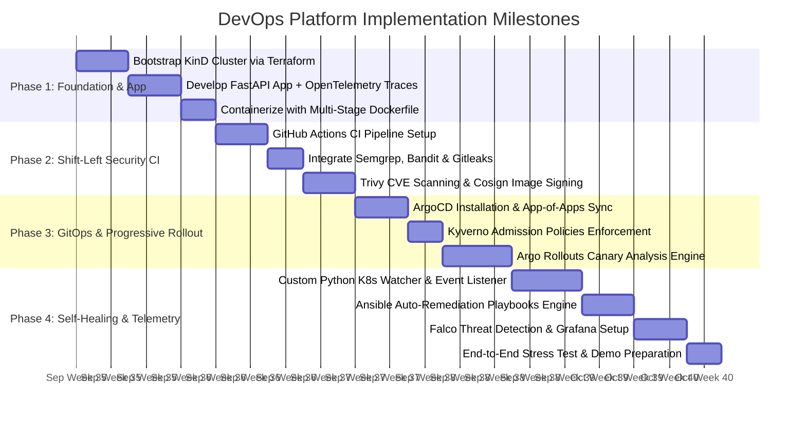

# 🛡️ Autonomous Zero-Trust GitOps & Self-Healing Cloud Platform

An enterprise-grade, zero-cost DevOps platform combining **Shift-Left Security**, **GitOps Continuous Delivery**, **Progressive Canary Routing**, and **Custom Autonomous Self-Healing**.

---

## 🎯 Project Roadmap & Implementation Plan

## 📋 Execution Phases & Deliverables

## Phase 1: Local Foundation & Observability-Ready App
- [x] Local Infrastructure: Provision a multi-node Kubernetes cluster locally using KinD via Terraform (`terraform/local-cluster/`).
- [x] Application Development: Build a lightweight FastAPI microservice (`app/main.py`) exposing health probes (`/healthz`) and synthetic load routes.
- [x] Tracing & Metrics: Modularize OpenTelemetry distributed tracing and Prometheus metrics into a separate `app/observability/` directory (`tracing.py` and `metrics.py`).
- [x] Secure Containerization: Create a hardened, non-root, multi-stage Dockerfile minimizing attack surface.

## Phase 2: Shift-Left Security & Automated CI Pipeline
- [x] Static Code Analysis (SAST): Run automated code quality and security scans using Semgrep and Bandit on every push.
- [x] Secret Detection: Scan commit history and diffs for leaked tokens/credentials via Gitleaks (`.gitleaks.toml`).
- [x] Vulnerability Management: Scan container image layers and OS dependencies using Trivy.
- [x] Supply Chain Security: Digitally sign container images using Cosign (Keyless / GitHub OIDC) before pushing to GitHub Container Registry (GHCR).

## Phase 3: Declarative GitOps & Progressive Delivery
- [x] GitOps Deployment: Configure ArgoCD (`k8s/argocd/application.yaml`) to automatically reconcile cluster state against manifests in the Git repository.
- [x] Admission Control: Deploy Kyverno policies (`k8s/kyverno/`) to enforce image signature verification (blocking unsigned images) and prevent root execution.
- [x] Canary Rollouts: Configure Argo Rollouts (`k8s/base/rollout.yaml`) for automated traffic shifting ($10\% \rightarrow 50\% \rightarrow 100\%$).
- [x] Automated Analysis: Implement Prometheus-driven health evaluation (`k8s/base/analysis-template.yaml`) that automatically triggers zero-downtime rollbacks if error rates exceed $1\%$.

## Phase 4: Runtime Security, Self-Healing & Monitoring
- [x] Runtime Security: Deploy Falco (`k8s/falco/falco-rules.yaml`) to monitor Linux kernel system calls for unauthorized container escapes or rogue interactive shells.
- [x] Autonomous Python Watcher: Run a background Python daemon (`operator/watcher.py`) listening to Kubernetes API events (`CrashLoopBackOff`, `OOMKilled`, `DiskPressure`).
- [x] Automated Remediation: Trigger Ansible Runner playbooks (`ansible/playbooks/`) to auto-clean logs, restart stuck system services, or safely cordon and drain degraded nodes.
- [x] Unified Dashboards: Route all metrics and traces to Prometheus, Grafana, and OpenTelemetry (`terraform/observability-helm.tf`) for real-time visibility.

🎓 College Demonstration & Live ScenariosDemo ScenarioTrigger / ActionExpected Automated Outcome1. Unsigned Image BlockAttempt to deploy a manual, unsigned Docker image.Kyverno rejects the deployment with admission validation error.2. Canary Failure & RollbackPush a v2 release with an injected 500 error route.Argo Rollouts routes 10% traffic, catches high error rate in Prometheus, and auto-aborts rollout.3. CrashLoop Self-HealingInject memory leak / force container crash loop.Python Watcher intercepts pod failure event and triggers Ansible auto-remediation.4. Runtime Threat AlertExec into container and spawn /bin/sh or edit /etc/passwd.Falco detects unauthorized privilege escalation and flags security alert.