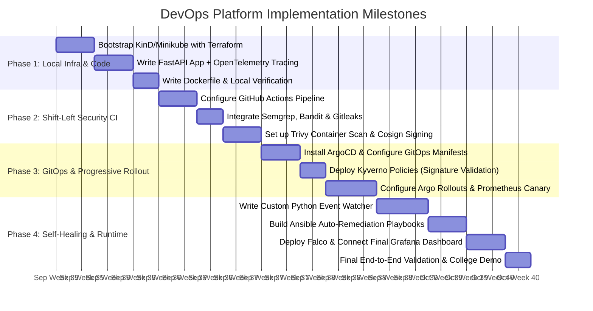
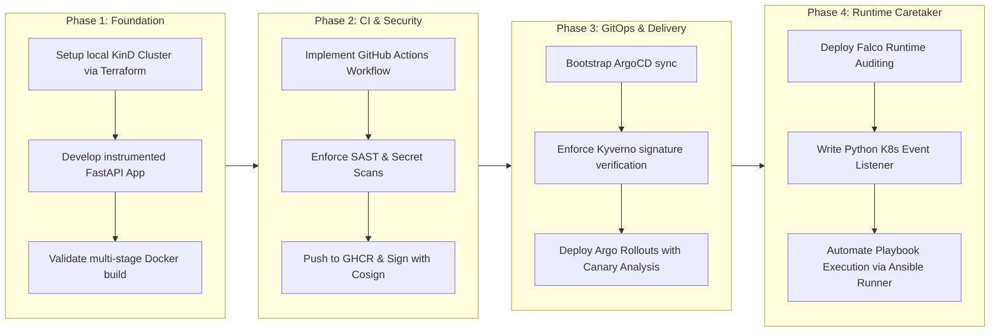

# Project Implementation Plan & Execution Roadmap

This document outlines the four phases required to build, test, and deploy the Zero-Cost DevOps Platform.

---

## Detailed Step-by-Step Task Checklist

